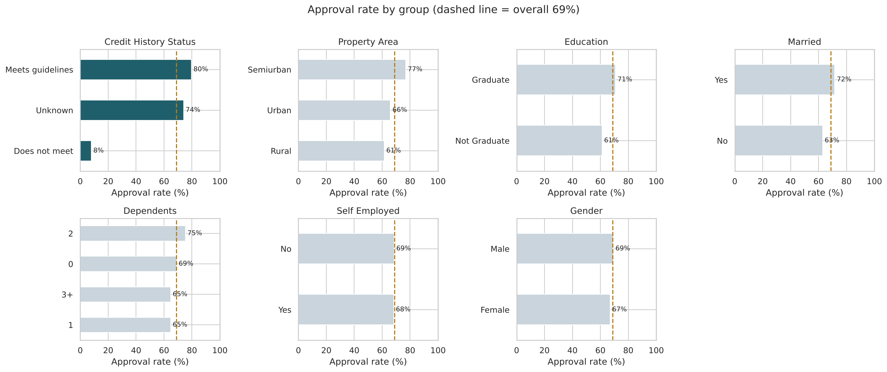
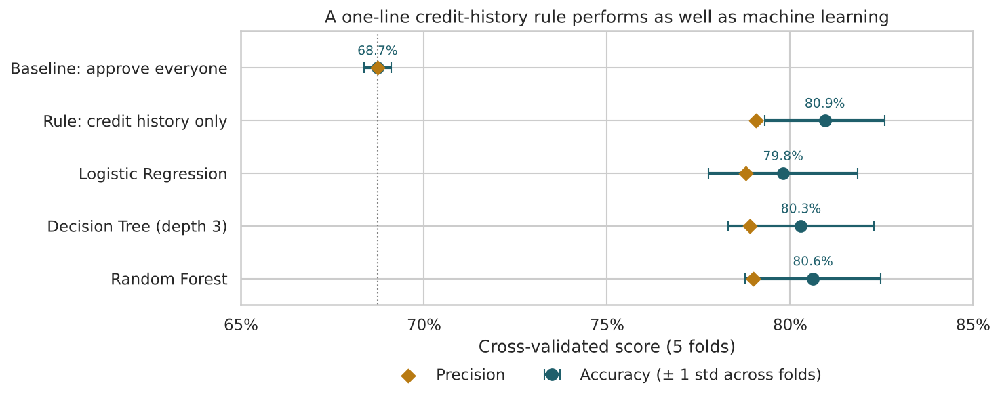

# Loan Approval Analysis

**What decides whether a home loan is approved? Credit history, almost entirely. A one-line rule based on it is as accurate as machine learning.**

Of 614 loan applications, 69% were approved. Applicants who meet credit guidelines were approved 80% of the time; those who don't, 8%. Income made no visible difference.



## Business question
A housing finance company wants to understand what drives its loan approvals and whether the first screening step could be automated.

## Data
- **Source:** Loan Prediction dataset (Analytics Vidhya practice problem)
- **Size:** 614 applications × 13 columns
- **Key fields:** gender, marital status, dependents, education, self-employment, applicant and co-applicant income, loan amount and term, credit history, property area, loan status

## Approach
1. **Data quality:** found missing values in 7 columns. Kept missing credit history as its own "Unknown" group instead of filling it with the most common value, because those 50 applicants are approved at a different rate (74%).
2. **Feature engineering:** total household income, approximate monthly instalment (EMI) and instalment-to-income ratio.
3. **Analysis:** approval *rates* by group, income bands, and credit history × property area.
4. **Statistical tests:** chi-square with Cramér's V, and Mann-Whitney U for skewed income data.
5. **SQL:** answered the key questions in SQLite using `CASE`, CTEs and window functions (`RANK`, `NTILE`, `AVG() OVER`).
6. **Modelling:** compared a credit-history rule with logistic regression, a decision tree and a random forest using 5-fold stratified cross-validation, with all preprocessing inside a scikit-learn pipeline.

## Key findings
| Finding | Number |
| --- | --- |
| Overall approval rate | 68.7% |
| Approval rate: credit history meets guidelines | 79.6% |
| Approval rate: credit history does not meet guidelines | 7.9% |
| Approval rate: credit history unknown | 74.0% |
| Strength of credit history effect (Cramér's V) | 0.54 (large) |
| Approval rate across income quartiles | 68–71% (flat) |
| Semi-urban vs rural approval, good credit only | 87.7% vs 71.5% |



| Approach (5-fold CV) | Accuracy | Precision |
| --- | --- | --- |
| Approve everyone (baseline) | 68.7% | 68.7% |
| **Rule: credit history only** | **80.9%** | 79.1% |
| Logistic Regression | 79.8% | 78.8% |
| Decision Tree (depth 3) | 80.3% | 78.9% |
| Random Forest | 80.6% | 79.0% |

## Recommendations
- **Use credit history as the first, automatic screening step.** It is as accurate as the models tested, and easy to explain to applicants and regulators.
- **Send applications with missing credit history to manual review** rather than assuming they are good.
- **Review how affordability is assessed.** Income has no visible effect on approval; linking this data to repayment outcomes would show whether that leads to defaults.
- **Look into the semi-urban advantage**, which may point to an underserved rural market.

## Limitations
- 614 applications is a small sample; some groups have fewer than 60 applicants.
- The data records approvals, not repayments, so a model trained on it copies past decisions, including any mistakes or bias.
- Units for loan amount and income are not documented, and the EMI estimate ignores interest.

## Files
| File | What it is |
| --- | --- |
| `loan_approval_analysis.ipynb` | Full analysis, including SQL queries (runs top to bottom) |
| `loanprediction.csv` | Dataset |
| `images/` | Charts used in this README |
| `requirements.txt` | Python packages |

## How to run
```
pip install -r requirements.txt
jupyter notebook loan_approval_analysis.ipynb
```

**Tools:** Python, Pandas, NumPy, SQL (SQLite), Matplotlib, Seaborn, SciPy, Scikit-learn
